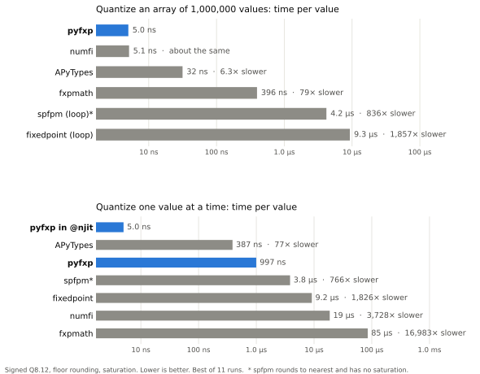

[](https://badge.fury.io/py/pyfxp)
[](https://github.com/ericsmacedo/pyfxp/actions/workflows/main.yml)
[](https://pyfxp.readthedocs.io/en/stable/)
[](https://coveralls.io/github/ericsmacedo/pyfxp?branch=main)
[](https://pypi.python.org/pypi/pyfxp)
[](https://semver.org/)

[](https://docs.github.com/en/pull-requests/collaborating-with-pull-requests/proposing-changes-to-your-work-with-pull-requests/creating-a-pull-request)
[](https://github.com/ericsmacedo/pyfxp/issues)

# pyfxp

**Bit-true fixed-point arithmetic for Python, at compiled speed.**

Model the datapath of your FPGA, ASIC or DSP firmware in Python. Pick the word
length, the rounding and the overflow behavior, and get exactly the numbers the
hardware will produce: on plain floats and NumPy arrays, from Python or inside
Numba `@njit` loops.

[Documentation](https://pyfxp.readthedocs.io/en/stable/) ·
[Getting started](https://pyfxp.readthedocs.io/en/stable/getting-started/) ·
[API reference](https://pyfxp.readthedocs.io/en/stable/api/) ·
[Comparison](https://pyfxp.readthedocs.io/en/stable/comparison/) ·
[Changelog](https://github.com/ericsmacedo/pyfxp/blob/main/CHANGELOG.md) ·
[llms.txt](https://pyfxp.readthedocs.io/en/stable/llms.txt)

## Installation

```bash
pip install pyfxp
```

<!-- docs: the landing page has the sections below, up to the next marker -->

## A fixed-point FIR filter, end to end

```python
import numpy as np
from numba import njit
from pyfxp import Q, fxp, to_hex
from pyfxp.constants import HALF_EVEN, SAT

x_spec = Q(1, 15, rnd=HALF_EVEN, ovf=SAT)   # ADC samples:   sQ1.15
h_spec = Q(1, 15, rnd=HALF_EVEN, ovf=SAT)   # filter taps:   sQ1.15
acc    = x_spec.mul(h_spec).acc(32)         # accumulator:   sQ7.30, can't overflow
y_spec = Q(1, 15, rnd=HALF_EVEN, ovf=SAT)   # output register

@njit                                       # pyfxp runs inside compiled loops
def fir(x, h, acc, y_spec):
    y = np.zeros_like(x)
    for n in range(h.size - 1, x.size):
        s = 0.0
        for k in range(h.size):
            s = fxp(s + x[n - k] * h[k], acc)
        y[n] = fxp(s, y_spec)
    return y

h = fxp(np.hanning(32) / np.hanning(32).sum(), h_spec)
x = fxp(0.9 * np.sin(np.linspace(0, 20, 10_000)), x_spec)
y = fir(x, h, acc, y_spec)

to_hex(y, y_spec)                           # expected values for your RTL testbench
```

## Why pyfxp

- **Bit-true.** Nine rounding modes, wrap / saturate / error on overflow, formats up to 64 bits.
  Every mode is property-tested against an exact rational-arithmetic reference.
- **Fast where it counts.** About 5 ns per sample inside `@njit` loops, and as fast as the fastest
  library on NumPy arrays. The only Python fixed-point library that works inside Numba.
- **Plain floats and NumPy.** No custom number type: results are floats and float64 arrays, so
  SciPy, Matplotlib and the model you already have keep working.
- **Hardware-ready.** `to_int`, `to_hex` and `to_bin` give the stored integers and two's-complement
  patterns for `$readmemh` test vectors, exact at every width.
- **Bit growth, computed.** `a.mul(b)`, `a.add(b)` and `a.acc(n)` return the smallest format that
  holds the exact result, so intermediate values never overflow by accident.
- **Readable formats.** `Q(3, 13, True, HALF_EVEN, SAT)` prints as `sQ3.13(HALF_EVEN, SAT)`, and
  swapping the rounding and overflow arguments is an error, not a silent bug.

## Performance

Quantizing to `sQ8.12` with floor rounding and saturation, compared with the other
Python fixed-point libraries (log scale, lower is better):

<picture>
  <source media="(prefers-color-scheme: dark)" srcset="https://raw.githubusercontent.com/ericsmacedo/pyfxp/main/docs/_static/compare-dark.svg">
  
</picture>

On arrays, pyfxp and numfi are the fastest, within run-to-run noise of each other.
The difference that matters for DSP models is per-sample code: inside an `@njit`
loop pyfxp takes about 5 ns per value, while the other libraries can only be
called from Python, at 0.4 µs or more per call.

| | pyfxp | numfi | APyTypes | fxpmath | fixedpoint | spfpm |
|---|:-:|:-:|:-:|:-:|:-:|:-:|
| Result is a plain float / NumPy array | ✔ | — | — | — | — | — |
| Vectorized over NumPy arrays | ✔ | ✔ | ✔ | ✔ | — | — |
| Quantize inside Numba `@njit` code | ✔ | — | — | — | — | — |
| Formats wider than 64 bits | — | ✔ | ✔ | ✔ | ✔ | ✔ |

See the [full comparison](https://pyfxp.readthedocs.io/en/stable/comparison/) for the method, the numbers and the details.

<!-- docs: end -->

## Quick Start

`pyfxp` offers two ways to convert numbers to a fixed-point format:

- **[fxpt](https://pyfxp.readthedocs.io/en/stable/api/fxpt/)** → “typed” (parameter-based)
    Pass the format directly as function parameters.
- **[fxp](https://pyfxp.readthedocs.io/en/stable/api/fxp/)** → “spec-based” (explicit FxpSpec)
    Build a reusable spec with [`Q(...)`](https://pyfxp.readthedocs.io/en/stable/api/Q/), then pass that spec.


Use the `fxpt` function when the format is simple or used in a single place:

```python
from pyfxp import fxpt
from pyfxp.constants import SAT, HALF_EVEN  # overflow & rounding modes

y = fxpt(
    x=3.14159,
    qi=3,            # integer bits (including sign when signed=True)
    qf=13,           # fractional bits
    signed=True,     # signed or unsigned format
    ovf=SAT,         # overflow behavior: WRAP | SAT | ERROR
    rnd=HALF_EVEN,   # rounding: TRUNC, CEIL, TO_ZERO, AWAY, HALF_UP, ...
)
```

> [!NOTE]
> **ARM-style Q-format**
>
> In ARM-style Q-format notation (used by `pyfxp`), the **sign bit is included** in the integer bit count `qi`.
> Refer to [Q (number format)](https://en.wikipedia.org/wiki/Q_(number_format)) for more information.

Use `fxp` when you want a reusable, readable definition. The fixed-point format is defined
using the [`Q(...)`](https://pyfxp.readthedocs.io/en/stable/api/Q/) function once, and can be
reused for different `fxp` calls:

```python
import numpy as np
from pyfxp import fxp, Q
from pyfxp.constants import SAT, HALF_EVEN

# Define the format once
Q3_13 = Q(qi=3, qf=13, signed=True, ovf=SAT, rnd=HALF_EVEN)

# Reuse it across your codebase
y1 = fxp(3.14159, Q3_13)
y2 = fxp(np.array([0.1, 0.2, 0.3]), Q3_13)
```

[`Q(...)`](https://pyfxp.readthedocs.io/en/stable/api/Q/) returns an [FxpSpec](https://pyfxp.readthedocs.io/en/stable/api/FxpSpec/) instance
which is basically a named tuple containing the specs used by `fxp`.

When specifying the fixed-point specs using either `fxpt` or `Q`,
all the following rounding and overflow modes are supported:

**Rounding modes**:

| Constant | Description |
|-----------|--------------|
| `TRUNC` | Bit truncation (rounds toward negative infinity) |
| `CEIL` | Round toward positive infinity |
| `TO_ZERO` | Round toward zero |
| `AWAY` | Round away from zero |
| `HALF_UP` | Round to nearest; ties toward positive infinity |
| `HALF_DOWN` | Round to nearest; ties toward negative infinity |
| `HALF_EVEN` | Round to nearest; ties to even |
| `HALF_ZERO` | Round to nearest; ties toward zero |
| `HALF_AWAY` | Round to nearest; ties away from zero |

**Overflow modes**:

| Constant | Description |
|-----------|--------------|
| `WRAP` | Wrap around on overflow (modular arithmetic) |
| `SAT` | Saturate at the maximum/minimum representable value |
| `ERROR` | Raise an exception on overflow |

The constants above are defined in the [`pyfxp.constants`](https://pyfxp.readthedocs.io/en/stable/api/constants/) module.
They are used by both `fxpt` and `fxp` to specify fixed-point arithmetic behavior.

> [!TIP]
> **Usage example**
>
> The modes are `IntEnum` members: they print by name (`<Rounding.HALF_EVEN: 6>`) but are plain integers everywhere else,
> so the numeric codes (`rnd=6`) keep working and the modes can be used inside `@njit` code.
> `Q(...)` converts integer codes to members, and passing a `Rounding` member as `ovf` (or the reverse) raises a `TypeError`.
>
> ```python
> from pyfxp.constants import SAT, HALF_EVEN
> fxpt(1.25, qi=3, qf=13, ovf=SAT, rnd=HALF_EVEN)
> ```
